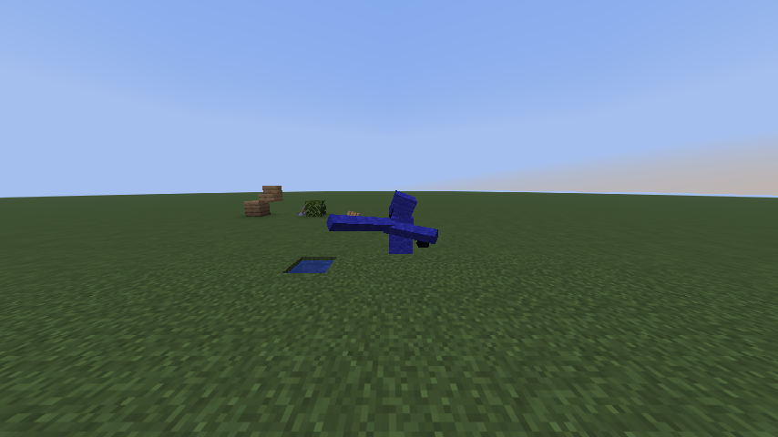

# GorillaCraft

Play Minecraft in VR as a Gorilla Tag gorilla. **Minecraft is the VR game**: it renders both eyes
itself through OpenXR (WiVRn, SteamVR, Oculus...) with all of its own graphics. **Gorilla Tag
provides the gorilla**: when Minecraft starts it starts Gorilla Tag in the background, without
VR, and Gorilla Tag's own arm locomotion moves you around Minecraft's blocks. Its real gorilla
model is what you (and everyone else) see in Minecraft. You climb Minecraft's blocks, punch them
out with Minecraft's mining rules, and place blocks, open doors and flip levers with your hands.

Modelled on [SkyCraft](https://github.com/RyanCraighead/SkyCraft) (Minecraft in Skyrim) and its
rule that **neither game is rewritten**: Minecraft does the world and the picture (blocks,
lighting, mining, placement rules, saving), Gorilla Tag does the gorilla's movement. Two small mods
translate between them.

Tag features aren't in yet. This is interactions and maps only.

## How it fits together

```
 headset + controllers ──OpenXR──> Minecraft (Fabric mod)  ──tracking──>  Gorilla Tag (BepInEx plugin, no VR)
                                    draws both eyes            <──rig, bones, punches──  gorilla locomotion on
                                    + menus, your gorilla                                  Minecraft's blocks (colliders)
```

Every frame Minecraft sends the headset and controllers to Gorilla Tag, which puts them on its
gorilla. Gorilla Tag's physics move the gorilla through Minecraft's blocks (they're invisible
colliders there) and send back where its rig ended up. Minecraft draws your eyes through that
rig, so where you are in Minecraft is where Gorilla Tag's physics put you. Your head itself
always comes straight from the headset (no added latency); only movement goes through Gorilla
Tag.

## What works

- **Minecraft in VR (OpenXR):** each eye drawn with its own position and field of view, at the
  headset's resolution and refresh rate. Works with any OpenXR runtime that takes OpenGL
  (WiVRn and Monado on Linux, SteamVR/Oculus on Windows). The desktop window mirrors an eye.
  Nobody wearing the headset: Minecraft plays normally on the monitor.
- **Starts Gorilla Tag for you:** launching the GorillaCraft instance starts Gorilla Tag through
  Steam (`-gorillacraft`), in a small window, muted, with VR off and its cameras off.
- **Gorilla movement:** Gorilla Tag's own locomotion (climbing, jumping, sliding, snap turn) on
  Minecraft's blocks, streamed around you (4 chunks by default).
- **Your gorilla:** Gorilla Tag's real gorilla model, read from your own installed Gorilla Tag at
  runtime (nothing from the game is shipped), posed with Gorilla Tag's bones. You see your own
  arms and body (not the head you're inside); everyone else sees the whole gorilla.
- **Breaking and placing:** point a controller at a block. **Left trigger** breaks (hold it,
  like left click; hits mobs too), **right trigger** uses the held item (like right click:
  place, open doors, eat, bows). Minecraft draws the block outline where you point.
- **Room-scale breaking:** punch a block with your real hand (into it, faster than 3 m/s) and
  Minecraft mines it for a moment: creative breaks in one punch, survival takes several.
- **Held item** in your right hand; other players hold theirs too.
- **Swimming:** Minecraft's water is Gorilla Tag water: float, swim with arm strokes, jump out
  at the surface, the Gorilla Tag way.
- **Survival:** moving costs a little hunger (measured from how far the gorilla travels, every
  10 seconds: about 400 blocks per half drumstick). Hostile mobs see and attack gorillas.
  Spears' charge attack is always on: run at a mob with a spear and it hits as hard as you're
  moving. (Server-side: needs GorillaCraft on the server too.)
- **Menus in VR:** Minecraft's own screens (title screen, worlds, servers, options, inventory,
  chests, crafting) float in front of you. Point with the right hand, **trigger** clicks, **grip**
  right-clicks, right stick scrolls, **B** closes. **Y** opens the inventory, the **menu**
  button pauses, left stick click re-centres the panel.
- **HUD** (hotbar, health, hunger, XP, chat) on the back of your left hand. **A**/**X** or left stick left/right change slots.
- **Gorillas in multiplayer:** every GorillaCraft player is a gorilla. Players with the mod see
  Gorilla Tag's real gorilla; players without it see a block-built gorilla (display entities) in
  the Gorilla Tag colour, holding the held item. Player models are hidden.

  
- **Multiplayer:** a Fabric 26.3 server with GorillaCraft and Fabric API; join it from
  Minecraft's multiplayer screen like any server.

**Windows players: follow the [step-by-step Windows guide](docs/WINDOWS-GUIDE.md)** (it has a
Linux section too). Downloads are on the [releases page](https://github.com/easyax2/gorillacraft/releases).

## Requirements

- A PC VR headset with an **OpenXR runtime** running: WiVRn (Quest on Linux), SteamVR, Oculus/Meta
  Link, Virtual Desktop... Minecraft must use its **OpenGL** renderer (the default).
- **Gorilla Tag** (Steam) with **BepInEx 5** and the GorillaCraft plugin.
- **Prism Launcher** with your Microsoft account (owning Minecraft: Java Edition). Start Gorilla
  Tag once with the plugin installed: it creates the **GorillaCraft** instance (Minecraft 26.3 +
  Fabric + Fabric API + the mod) in Prism. After that you only start that instance.
- On a Minecraft server, install `gorillacraft-fabric-<version>+26.3.jar` and Fabric API too.

## Playing

1. Start your VR runtime (WiVRn, SteamVR...) and put the headset on.
2. Start **Gorilla Tag** from Steam. With GorillaCraft it opens in a small window with VR off
   (your gorilla's body) and starts the **GorillaCraft** instance in Prism, which opens in the
   headset. (On Linux, Steam starts Prism through Gorilla Tag's launch options, see the guide.)
   Starting the GorillaCraft instance first works too: Minecraft then starts Gorilla Tag. With
   SteamVR, start Gorilla Tag first: SteamVR hands the headset to any game Steam starts.
3. Minecraft opens a creative world called GorillaCraft (or pick one from the menu). As soon as
   Gorilla Tag is connected you're a gorilla: climb, punch, build.

To play normal Gorilla Tag in VR, set `PlayInMinecraft = false` in
`BepInEx/config/dev.gorillacraft.cfg`.

## Configuration

Minecraft: `config/gorillacraft.properties`

| Setting | Default | |
|---|---|---|
| `vr` | `true` | Use the headset when an OpenXR runtime is there |
| `vrResolution` | `1.0` | Eye resolution relative to the runtime's recommendation (0.3–2) |
| `launchGorillaTag` | `true` | Start Gorilla Tag through Steam when Minecraft starts |
| `port` | `47123` | Link port (must match Gorilla Tag's) |
| `radius` / `verticalRadius` / `sectionsPerTick` | `4` / `4` / `6` | How much of the world becomes Gorilla Tag colliders |

Gorilla Tag: `BepInEx/config/dev.gorillacraft.cfg`

| Setting | Default | |
|---|---|---|
| `Link.Host` / `Link.Port` | `127.0.0.1` / `47123` | Where Minecraft listens |
| `Map.Anchor` | `0, 1500, 0` | Where Minecraft's spawn point sits in Gorilla Tag's world, far from Gorilla Tag's own maps |
| `Map.BlockScale` | `1` | Size of a block in Gorilla Tag units (meters) |
| `Hands.TouchDistance` | `0.12` | How close a hand must be to a block to punch or use it |
| `Hands.PunchSpeed` / `PunchHold` / `FistMode` | `3.0` / `0.4` / `false` | What counts as a punch, how long each punch mines, fist mode |
| `Minecraft.AutoInstall` / `PrismPath` / `PrismDataDir` / `World` | `true` | Keep the Prism instance set up, and where Prism is |
| `Performance.SectionsPerFrame` | `4` | Collider builds per frame |

## Known limitations

- **Not tested while wearing a headset yet.** Minecraft's OpenXR session, both eye pictures and
  the GUI panel are tested against WiVRn, and Gorilla Tag starts without VR and connects, but
  playing with it on hasn't been tried. Expect tuning: hand offsets, panel and wrist positions.
- Gorilla Tag must run for the gorilla to move. Without it you stand where the Minecraft player
  is and can use the menus.
- VR needs Minecraft's OpenGL renderer, not Vulkan.
- Both eyes are drawn every frame: a heavy world costs twice what it does on a monitor. Lower
  render distance or `vrResolution` if frames drop.
- If you die in Minecraft (survival), you respawn straight away.

## Building

```bash
cd fabric && ./gradlew build                              # → fabric/build/libs/gorillacraft-fabric-*.jar
cd gorillatag && dotnet build -c Release                  # → gorillatag/bin/Release/GorillaCraft.dll (embeds the jar above + Fabric API)
cd gorillatag && dotnet build -c Release -p:Deploy=true   # also copies it to BepInEx/plugins/GorillaCraft
```

`GamePath` defaults to the usual Steam path on Linux; pass `-p:GamePath=...` otherwise.

## Testing

`tools/linktest` is a stand-in for Gorilla Tag, built from the plugin's own link and parsing
code (`gorillatag/src/{Proto,Wire,LinkClient,Messages}.cs`). It drives a real Minecraft client
running a Fabric client gametest:

```bash
export GORILLACRAFT_TEST_DIR=/tmp/gorillacraft-test && rm -rf $GORILLACRAFT_TEST_DIR
(cd fabric && ./gradlew runClientGameTest) &
(cd tools/linktest && dotnet run -c Release)
```

It checks the atlas, meshes, shapes, face winding and collision culling. It also enters the map,
switches hotbar slots, mines, places, flips a lever, follows a `/tp`, then plays on a dedicated
server (avatars included). The gametest then checks the results in the server's world.

VR in a dev run: `GORILLACRAFT_VR=1 ./gradlew runVrClient` (opens a test world in the headset).
`GORILLACRAFT_VR_FORCE_RENDER=1` draws the eyes without anyone wearing the headset, and
`GORILLACRAFT_VR_DUMP=<frame>` saves both eyes and the GUI as PNGs on that frame.

## Layout

| Folder | |
|---|---|
| `fabric/` | Minecraft Fabric mod (Java 25, MC 26.3) |
| `gorillatag/` | Gorilla Tag BepInEx plugin (C#, netstandard2.1) |
| `protocol/` | The link protocol between them |
| `tools/linktest/` | Gorilla Tag stand-in for end-to-end tests |

## License

[MIT](LICENSE). Design after SkyCraft (MIT, © 2026 chasmlol); no code is shared with it.
